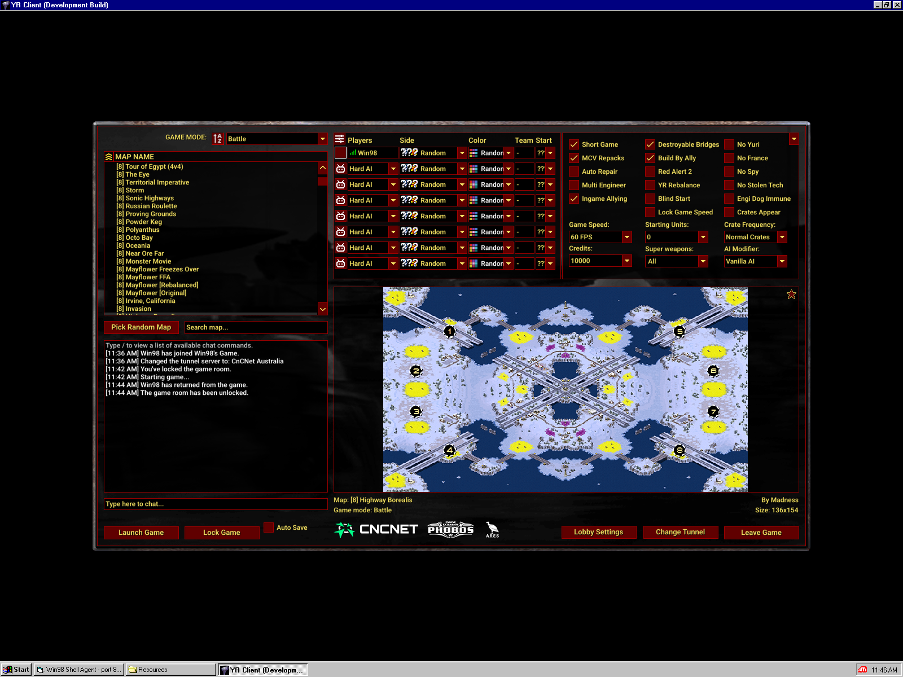

# CnCNet clients on Windows 98

Run the [CnCNet](https://cncnet.org) client for **Red Alert 2 / Yuri's Revenge** (and the other
XNA-based CnCNet clients, such as Dawn of the Tiberium Age) on **Windows 98 SE** - main menu,
CnCNet lobby and chat, the updater, and playing the game, including Ares and Phobos.

It builds on [.NET Framework 4.8 for Windows 98](https://github.com/11EJDE11/dotnet48-win98),
which runs the client itself. This project adds what the client needs beside it: Microsoft's XNA,
DirectX and Visual C++ runtime DLLs (downloaded and prepared by a script) and a few small
replacement DLLs.

## Quick start (Red Alert 2 / Yuri's Revenge)

1. Set up the Windows 98 SE machine: [KernelEx 4.5.2](http://kernelex.sourceforge.net/),
   [DirectX 9.0c](https://web.archive.org/web/20130512082448/http://download.microsoft.com/download/8/c/9/8c968ecc-8402-49f3-aacb-dc4c5d230a9a/directx_dec2006_redist.exe)
   (December 2006, the last release for Windows 98) and
   [.NET Framework 4.8 for Windows 98](https://github.com/11EJDE11/dotnet48-win98#quick-install).
2. On a modern Windows PC, get Red Alert 2 and Yuri's Revenge - your own copy, or the
   [archive.org copy](https://archive.org/details/red-alert-2_202103) - and install CnCNet into it
   with the [CnCNet Yuri's Revenge installer](https://downloads.cncnet.org/CnCNet5_YR_Installer.exe).
3. Copy the whole game folder to the Windows 98 machine.
4. Download the [latest release](https://github.com/11EJDE11/cncnet-win98/releases) and extract
   it into the game folder, so `CNCNET98.BAT` and the `Win98` folder sit beside `Resources`.
5. With the Windows 98 machine online, run `CNCNET98.BAT`.
6. Start the client by running `Resources\clientxna.exe` (a desktop shortcut to it is handy).
7. **After every CnCNet update, run `CNCNET98.BAT` again** - updates can replace files it set up.

## What CNCNET98.BAT does

Run from the game folder, it:

- Downloads three Microsoft redistributables into `Win98\DL` and checks their SHA-1 hashes:
  - [XNA Framework 4.0 Refresh](https://download.microsoft.com/download/5/3/A/53A804C8-EC78-43CD-A0F0-2FB4D45603D3/xnafx40_redist.msi):
    `XnaNative.dll`, plus the `d3dx9_41.dll` and `X3DAudio1_7.dll` it carries, and the
    managed XNA assemblies (`Microsoft.Xna.Framework*.dll`) for clients that do not ship their own
    (on Windows the redistributable puts them in the GAC; Dawn of the Tiberium Age 15 relies on that).
  - [Visual C++ 2010 SP1 runtime](https://download.microsoft.com/download/1/6/5/165255E7-1014-4D0A-B094-B6A430A6BFFC/vcredist_x86.exe):
    `MSVCR100.dll` and `MSVCP100.dll` (10.0.40219.325).
  - [Windows Imaging Component for Windows XP](https://download.microsoft.com/download/f/f/1/ff178bb1-da91-48ed-89e5-478a99387d4f/wic_x86_enu.exe):
    `WindowsCodecs.dll` and friends, which XNA uses to decode textures.
- Takes those DLLs out of the packages. Windows 98 cannot run the installers themselves.
- Changes the import tables of `MSVCR100.dll`, `MSVCP100.dll`, `WindowsCodecs.dll`,
  `WindowsCodecsExt.dll` and the client's `Microsoft.Xna.Framework.dll` so they load the
  .NET-for-Windows-98 replacements for `KERNEL32`, `ADVAPI32`, `ole32` and `ntdll`. Only DLL
  names in the import table change; the originals are kept as `.ORG`.
- Copies them, and this project's DLLs from `Win98`, into `Resources` and, when the client has
  it, `Resources\Binaries\XNA`. Old copies of .NET-for-Windows-98 DLLs left there by an earlier
  manual setup (such as `CORADV32.DLL`) are deleted, so the installed ones are used. It needs the
  current release of .NET Framework 4.8 for Windows 98 (the one that installs `DNKERNEL.DLL`).
- If the game has `Syringe.exe` (Ares/Phobos), replaces it with
  [a build that works on Windows 98](https://github.com/11EJDE11/SyringeEx/releases/tag/win98-rel32-1)
  and keeps the original as `Win98\SYRINGE.ORG`. Why Syringe needs a fix is in
  [docs/syringe.md](docs/syringe.md).

Later runs use the copies in `Win98\DL`, so they work offline. Without an internet connection on
the Windows 98 machine, download the three packages and `Syringe.exe` on another computer and
put them in `Win98\DL` as `XNAFX40.MSI`, `VCREDIST.EXE`, `WIC.EXE` and `SYRINGE.EXE`.

## This project's DLLs

| File | What it does |
|---|---|
| `OLET3.DLL` | Stands in for `ole32` for XNA: creates the WIC image decoders and the XAudio2 object, which Windows 98's ole32 cannot. |
| `NTDTA.DLL` | The `ntdll` functions the WIC DLLs import that Windows 98 lacks. |
| `XAudio2_6.dll` | A no-op XAudio 2.6 engine, so XNA's audio starts on Windows 98, which has no XAudio2. Sounds played through XNA are silent. |

Sources are in `src`; `build.ps1` rebuilds them with Visual C++ 6.0.

## Known issues

- **"Change Tunnel" crashes the client.** The tunnel list's flag image is taller than XNA's
  "Reach" graphics profile allows, which affects the XNA build of the client on any PC. A fix
  has been prepared for the CnCNet client; until it ships, avoid that button.
- XNA sound effects are silent (see `XAudio2_6.dll` above). Game sound is unaffected.
- The first start after a reboot is slow (about 40 seconds).
- The CnCNet updater can replace `Syringe.exe` and `Microsoft.Xna.Framework.dll`; run
  `CNCNET98.BAT` again after updating.

## Tested with

Windows 98 SE, KernelEx 4.5.2, DirectX 9.0c, an ATI graphics card, the CnCNet Yuri's Revenge
client 2.13 with Ares and Phobos, and Dawn of the Tiberium Age 1.173 and 15.1.

## Credits

[CnCNet](https://cncnet.org) and the [XNA CnCNet client](https://github.com/CnCNet/xna-cncnet-client),
[Ares](https://github.com/Ares-Developers/Ares), [Phobos](https://github.com/Phobos-developers/Phobos)
and [SyringeEx](https://github.com/Phobos-developers/SyringeEx). The Microsoft DLLs are
downloaded from Microsoft and are not distributed here.
